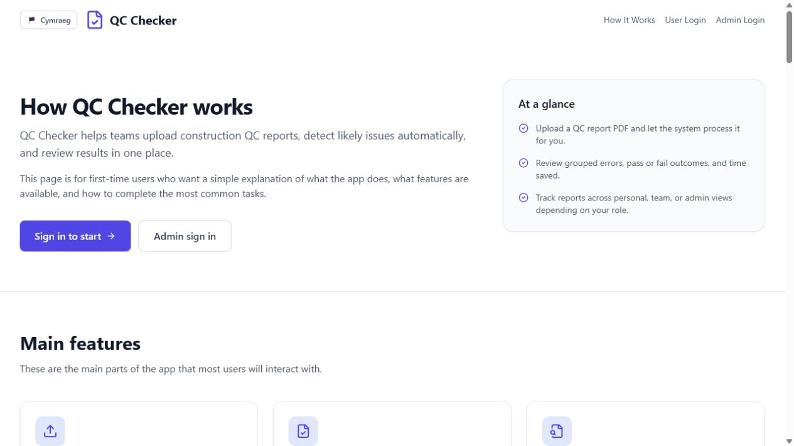
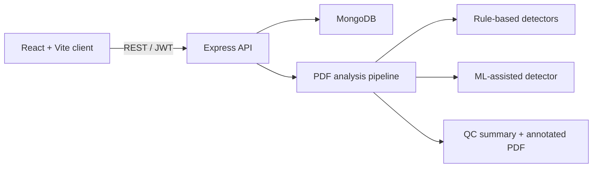

# QC Checker

An AI-assisted quality-control report analyser for the construction industry. QC Checker reviews uploaded PDF reports, identifies common quality issues, returns annotated feedback, and gives users, team leaders, and administrators role-specific analytics.

[](https://github.com/MoicoTiago/qc-checker/actions/workflows/ci.yml)




## Project overview

QC Checker was developed as a final-year Applied Software Engineering group project at Cardiff University. It demonstrates a production-style MERN architecture, automated report processing, role-based access control, bilingual English/Welsh content, analytics dashboards, accessibility preferences, and extensive automated testing.

This repository is a privacy-safe portfolio snapshot. Runtime uploads and training documents from the original university repository have been removed and are ignored by Git.

## Key features

- PDF upload, text extraction, rule-based quality checks, and ML-assisted analysis
- Downloadable QC summaries and annotated source PDFs
- JWT authentication, account lockout, rate limiting, and role-based permissions
- User, team-leader, and administrator dashboards
- Team goals, announcements, member comparison, and performance analytics
- Audit logs and configurable source-file retention
- English and Welsh translations
- Theme, contrast, colour-vision, font-size, and reduced-motion preferences
- 598 passing automated tests across the frontend and backend

## My contribution

I contributed 58 commits under two university email variants. My main areas of ownership included:

- building and refining team-member comparison and shared analytics services;
- keeping time-range filters and comparison results consistent across dashboards;
- implementing report-retention cleanup and its automated tests;
- expanding backend and frontend coverage for reports, profiles, administration, and team workflows;
- fixing failing backend tests and strengthening CI coverage checks;
- improving onboarding, public help content, accessibility, and annotated-PDF guidance;
- refining navigation and calculating estimated review time saved; and
- producing the final technical and feature documentation.

See [PORTFOLIO.md](PORTFOLIO.md) for a CV-focused breakdown of the engineering work and evidence from the original Git history.

## Architecture



## Technology

| Area | Tools |
| --- | --- |
| Frontend | React 18, React Router, Vite, Tailwind CSS, Recharts, Axios |
| Backend | Node.js, Express, Mongoose, JWT, Multer, Nodemailer |
| PDF and ML | PDF.js, pdf-lib, PDFKit, `@xenova/transformers` |
| Testing | Jest, Supertest, Vitest, React Testing Library |
| Automation | GitHub Actions, Dependabot |

## Getting started

### Requirements

- Node.js 20 or later
- npm 10 or later
- A MongoDB instance or MongoDB Atlas database

### Installation

```bash
git clone https://github.com/MoicoTiago/qc-checker.git
cd qc-checker
npm run install:all
```

Copy the example environment file:

```bash
cp .env.example backend/.env
```

On Windows PowerShell:

```powershell
Copy-Item .env.example backend/.env
```

Set at least these values in `backend/.env`:

```dotenv
MONGODB_URI=mongodb://127.0.0.1:27017/qc-checker
JWT_SECRET=replace-with-a-long-random-secret
PORT=5000
NODE_ENV=development
FRONTEND_URL=http://localhost:3000
```

Optional SMTP, ML, and report-retention settings are documented in [.env.example](.env.example).

### Run locally

```bash
npm run dev
```

- Frontend: `http://localhost:3000`
- Backend: `http://localhost:5000`
- Health check: `http://localhost:5000/api/health`

Demo data can be created and removed with:

```bash
cd backend
npm run seed:demo
npm run clear:demo
```

## Testing and build

```bash
# Backend
cd backend
npm test

# Frontend
cd ../frontend
npm test
npm run build
```

GitHub Actions runs both suites and the production frontend build on every push and pull request to `main`.

## Privacy and data handling

Uploaded and training PDFs are runtime data and must never be committed. The repository keeps only placeholder files in `backend/uploads` and `backend/training`; `.gitignore` excludes their contents. Use synthetic documents when demonstrating the application.

## Team and attribution

This was a collaborative Cardiff University Team 15a project by Tiago Moico, Alexandru Mataoanu, Saif Abuzinada, Summer Zhao, and Taylor Fereday. This clean public snapshot is maintained by Tiago Moico with the team's permission. Features described as my contribution above are based on authorship recorded in the original private GitLab history; the remaining work belongs to the wider team.

## Licence

Released under the [ISC Licence](LICENSE).
